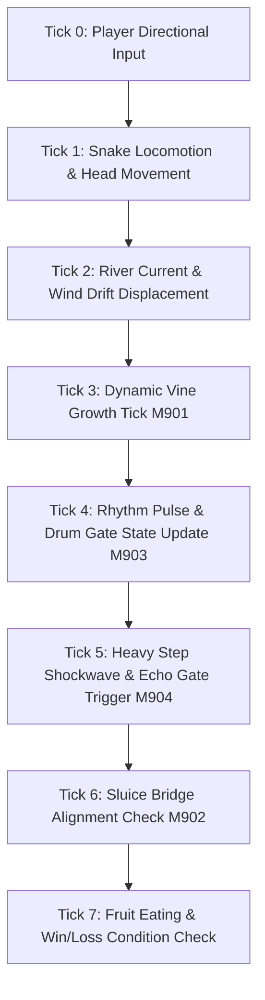

# Phase 19 — Signature Systems and Synergy Mechanics Technical Specification
**Phase:** 19 (Levels 9001–9500)  
**System:** Remix B — Phase 7 to Phase 12 Mechanics Synergy  
**Related Documents:** [01_PHASE_19_SCOPE_AND_RULES.md](01_PHASE_19_SCOPE_AND_RULES.md), [02_LEVEL_PLAN_9001_9500.md](02_LEVEL_PLAN_9001_9500.md), [../SHARED_CORE_STANDARD.md](../../SHARED_CORE_STANDARD.md)

---

## 1. Executive Mechanics Overview

Phase 19 માં late-game systems (P7 Gusts, P8 Vines, P9 Twin Rivers, P10 Rhythm Gates, P11 Reflection Ponds, P12 Monsoon & Heavy Python) ના 4 top synergistic mechanics કાર્યરત છે:

1. **M901: Wind-Driven Vine (P7 Wind × P8 Overgrown Vine)**
2. **M902: Split River Bridge (P9 Twin Rivers × P11 Reflection Ponds)**
3. **M903: Rhythm Gravity Cascade (P10 Drum Gate × P12 Monsoon Winds)**
4. **M904: Echo Weight Shift (P10 Echo Sequence × P12 Heavy Python)**

---

## 2. Detailed Technical Specifications

### 2.1 M901: Wind-Driven Vine
- **Concept:** વનસ્પતિના વેલા (Overgrown Vines) સામાન્ય રીતે ચોતરફ ફેલાય છે, પરંતુ Phase 19 માં dynamic Wind Current ($W_d \in \{\text{North, South, East, West}\}$) ના પ્રભાવ હેઠળ વેલા માત્ર પવનની દિશામાં જ વૃદ્ધિ (grow) પામે છે.
- **Rules & Logic:**
  - દર 2 moves એ vine growth tick થાય છે.
  - જો wind vector $\vec{W} = (0, 1)$ (South) હોય, તો vine tip માત્ર $(x, y+1)$ પર expand થઈ શકે છે.
  - જો પવન સામેની દિશામાં (opposing) wall અથવા obstacle હોય, તો વેલો અટકી જાય છે (growth suppressed).
  - સાપ પવનની દિશા બદલવા માટે Wind Switch Lever pull કરી શકે છે, જેથી વેલાનો માર્ગ divert થઈને closed doorway ખુલ્લી થાય છે.

### 2.2 M902: Split River Bridge
- **Concept:** Twin Rivers (P9) અને Reflection Ponds (P11) એકબીજા સાથે hydraulic sluice gates દ્વારા connected છે.
- **Rules & Logic:**
  - River flow vector $\vec{R}_A$ અને $\vec{R}_B$ parallel અથવા opposite વહે છે.
  - જ્યારે સાપ Reflection Pool માં submerged floating lily pad પર step કરે છે, ત્યારે Water Siphon Bridge activate થાય છે.
  - Siphon Bridge એ 2 rivers વચ્ચે crossing bridge બનાવે છે અથવા water current નો flow reverse કરે છે.
  - સાપ current સાથે 1 extra tile slide થઈ શકે છે (per `SHARED_CORE_STANDARD.md` conveyor/current logic).

### 2.3 M903: Rhythm Gravity Cascade
- **Concept:** Drum Gates (P10) ના polyrhythmic beat count સાથે Monsoon Storms (P12) ના torrential gusts sync થાય છે.
- **Rules & Logic:**
  - Rhythm cycle: 3 beats ($B_1, B_2, B_3$).
  - $B_1$ & $B_2$: Normal grid movement, drum gates neutral.
  - $B_3$ (Monsoon Downbeat): Monsoon Wind 1-tile force vector apply કરે છે. આ જ ક્ષણે Drum Gates toggle (Open $\leftrightarrow$ Closed) થાય છે.
  - HUD પર pulsing drum icon અને visual meter player ને આગામી beat ની ચોક્કસ જાણકારી આપે છે.

### 2.4 M904: Echo Weight Shift
- **Concept:** Heavy Python (P12) નું heavy body weight જ્યારે ground pressure tile અથવા stone block પર પડે છે ત્યારે seismic shockwave emit થાય છે, જે distant Echo Bells (P10) ને activate કરે છે.
- **Rules & Logic:**
  - Heavy body step generates shockwave radius $r = 4$ Manhattan distance tiles.
  - જો radius ની અંદર Echo Gate Bell હોય, તો તે resonant frequency પકડીને 3 turns માટે lock open કરે છે.
  - Light snakes shockwave generate કરી શકતા નથી; માત્ર 2x-weight heavy python segments જ આ seismic switch trigger કરી શકે છે.

---

## 3. Step-by-Step Tick Execution Pipeline

દરેક player move વખતે turn processing નીચેના કડક deterministic order માં થાય છે:

1. **Tick 0 (Input):** Player swipes directional move.
2. **Tick 1 (Locomotion):** Snake moves 1 tile forward; tail segments follow path.
3. **Tick 2 (Current Drift):** જો સાપ water current અથવા gale wind zone માં હોય, તો +1 tile displacement calculate થાય છે.
4. **Tick 3 (Vine Growth):** Wind-driven vine growth tick evaluates and claims open adjacent cell along wind vector.
5. **Tick 4 (Rhythm Beat):** Global beat counter increments ($n \pmod 3$). Beat 3 triggers drum gate toggles.
6. **Tick 5 (Echo Shockwave):** જો heavy segment active pressure tile પર land થાય, તો echo wave 4-tile radius માં propagate થઈને bells ring કરે છે.
7. **Tick 6 (Sluice Bridge):** Connected watergates adjust water height and bridge accessibility.
8. **Tick 7 (Resolution):** Fruit consumption, star triggers, victory/collision states evaluated.

---

## 4. Edge Cases & Safety Guardrails

- **Vine vs Snake Body Trapping:** જો Wind-driven vine સાપના શરીરની લાઈન તરફ ગતિ કરે, તો તે સાપના શરીર પર grow થઈ શકતો નથી; તે blocked ગણાય છે. સાપની tail ખાલી થયેલ cell પર જ vine પ્રવેશી શકે છે.
- **Opposing Wind & River Currents:** જો સાપ Northbound River માં તરતો હોય અને Southbound Wind gust આવે, તો Net Force Zero ($1 - 1 = 0$) થાય છે અને સાપ standstill રહે છે (no unintended teleportation or infinite loop).
- **Shockwave Cancellation:** જો shockwave radius માં 2 opposing weight drops એકસાથે થાય, તો constructive wave amplitude gate ને unlock જ રાખે છે, lock deadlock થતો નથી.
- **100% Deterministic Undos:** દરેક turn state (Snake positions, wind vector, river flow, vine length, rhythm beat count, gate states) complete snapshot તરીકે store થાય છે, જેથી single-turn undo સંપૂર્ણ deterministic રહે છે.
