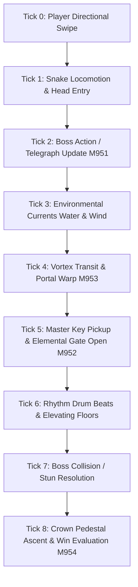

# Phase 20 — Signature Systems and Synergy Mechanics Technical Specification
**Phase:** 20 (Levels 9501–10,000)  
**System:** Grand Jungle Master & Level 10,000 Grand Finale  
**Related Documents:** [01_PHASE_20_SCOPE_AND_RULES.md](01_PHASE_20_SCOPE_AND_RULES.md), [02_LEVEL_PLAN_9501_10000.md](02_LEVEL_PLAN_9501_10000.md), [../SHARED_CORE_STANDARD.md](../../SHARED_CORE_STANDARD.md)

---

## 1. Executive Mechanics Overview

Phase 20 રમતના 14 signature systems નું ultimate convergence પૂરું પાડે છે, જેમાં 4 brand new Grand Combo Mechanics કેન્દ્રસ્થાને છે:

1. **M951: Apex Chieftain Mongoose (Grand Boss Encounter)**
2. **M952: Prismatic Master Key (Omni-Unlocking Token)**
3. **M953: Convergence Vortex (Multi-Dimensional Routing Portal)**
4. **M954: Jungle Crown Pedestal (The Sovereign Win Goal)**

---

## 2. Detailed Technical Specifications

### 2.1 M951: Apex Chieftain Mongoose (Grand Boss)
- **Concept:** એક વિશાળ 2x2 footprint ધરાવતો શિકારી મોંગૂસ (predator boss), જે ક્યારેય random attack કરતો નથી પરંતુ ચોક્કસ predictable pattern અને 1-turn telegraph સાથે કામ કરે છે.
- **State Machine:**
  ```mermaid
  stateDiagram-v2
      [*] --> Patrol
      Patrol --> Telegraph: Snake enters line-of-sight (<= 4 tiles)
      Telegraph --> Strike: Next turn execution
      Strike --> Stunned: Boss hits wall/obstacle/trapdoor
      Strike --> Capture: Snake remains in telegraph zone (Game Over)
      Stunned --> Patrol: 3 turns stun elapsed
  ```
- **Rules & Logic:**
  - **Telegraph Turn:** જ્યારે સાપ boss ના 4-tile linear corridor માં આવે, ત્યારે boss roar animation કરે છે અને target tiles પર bright red claw runic markings પ્રગટ થાય છે.
  - **Strike Action:** આગામી turn ના Tick 2 માં boss straight line માં 3 tiles rush કરે છે.
  - **Trap Baiting:** જો player સાપને બાજુ પર ખસેડી લે, તો boss આગળ વધીને heavy trapdoor, spike barrier અથવા river vortex માં ફસાઈ જાય છે અને 3 turns માટે stunned થઈ જાય છે.
  - **Zero Twitch Reflex:** Boss સંપૂર્ણ turn-based છે. Player ગમે તેટલો સમય વિચારીને swipe કરી શકે છે.

### 2.2 M952: Prismatic Master Key (Omni-Unlocking Token)
- **Concept:** અગાઉના તમામ phases ની જુદી જુદી locks (Burrow Gate, River Sluice, Drum Barrier, Solar Prism, Ice Seal) ને single pickup પર અનલૉક કરનારી સર્વશ્રેષ્ઠ ચાવી.
- **Rules & Logic:**
  - Board પર સ્થિત Master Key પર સાપનું માથું step કરે ત્યારે key collect થાય છે.
  - તે ક્ષણે board પર રહેલા તમામ elemental locks simultaneously open/active state માં switch થઈ જાય છે.
  - જો multiple gates હોય, તો key consumption sequence એક જ instant resolution tick માં solve થાય છે.

### 2.3 M953: Convergence Vortex (Multi-Dimensional Transit)
- **Concept:** Portal, conveyor river, seasonal cycle અને floor elevation નું unified cosmic routing nexus.
- **Rules & Logic:**
  - Vortex tile 1x1 glowing cosmic spiral છે.
  - જ્યારે સાપ vortex માં પ્રવેશે છે, ત્યારે તે linked exit vortex આગળ instant transition પામે છે અને exit direction vector મુજબ 1 tile glide પામે છે.
  - Vortex સાપના શરીરની લંબાઈ (tail integrity) જાળવી રાખે છે; tail segments seamless curvature સાથે vortex માંથી બહાર નીકળે છે.

### 2.4 M954: Jungle Crown Pedestal (Win Goal)
- **Concept:** રમતના દરેક phase 20 level માં final objective સામાન્ય exit gate નથી, પરંતુ પવિત્ર "Jungle Crown Pedestal" છે.
- **Rules & Logic:**
  - Pedestal board ના કેન્દ્રમાં અથવા elevated dais પર સ્થિત હોય છે.
  - Pedestal access કરવા માટે લેવલના તમામ Golden Sovereign Fruit ખાઈ લેવા અનિવાર્ય છે.
  - સાપનું માથું pedestal પર પહોંચતાં જ Crown Landing sequence રમાય છે: સોનાનો મુગટ સાપના માથા પર સ્થિર થાય છે, બોર્ડના તમામ દુશ્મનો શરણાગતિ સ્વીકારે છે, અને level complete થાય છે.

---

## 3. Level 10,000 Grand Climax: The 14-System Convergence Matrix

Level 10,000 ("Jungle Kingdom Crown") ના 12x12 royal board પર નીચેના તમામ 14 signature systems નું બરાબર 1 instance જીવંત છે:

| System # | Signature Feature | Instance Role in Level 10,000 |
| :--- | :--- | :--- |
| **1 (P1)** | Solar Burrow Hole | South-to-North hidden bypass tunnel |
| **2 (P2)** | Heavy Coconut Boulder | Rollable projectile to stun Mongoose Boss |
| **3 (P3)** | Cycle Floor Elevator | Rises on turn 4 to block boss charge corridor |
| **4 (P4)** | Temporal Season Dial | Shifts water channel to ice bridge on Winter beat |
| **5 (P5)** | Prismatic Glass Reflector | Deflects solar beam to melt ancient root lock |
| **6 (P6)** | Shadow Portal Ring | Warp gate connecting lower vault to upper dais |
| **7 (P7)** | Gust Wind Corridor | Eastward tailwind granting +1 movement boost |
| **8 (P8)** | Overgrown Vine Bramble | Natural barrier redirectable via wind lever |
| **9 (P9)** | Twin River Sluiceway | Rapid water currents surrounding outer moat |
| **10 (P10)** | Jungle Rhythm Drum Gate | 3-beat pulse controlling central fortress gates |
| **11 (P11)** | Reflection Pool Mirror | Step on lily pad to raise underwater stepping stone |
| **12 (P12)** | Heavy Python Stone Slam | Heavy segment weight breaks reinforced floor grate |
| **13 (P13-P18)**| Magnetic Lodestone & Vortex| M953 Convergence Vortex pulling metal tokens |
| **14 (P19-P20)**| Apex Mongoose Boss & Crown | M951 Boss prowling moat, M954 Crown Pedestal on dais |

---

## 4. Master Tick Execution Pipeline



1. **Tick 0 (Input):** Player swipes move direction.
2. **Tick 1 (Locomotion):** Snake steps forward; segments follow path.
3. **Tick 2 (Boss Logic):** Mongoose evaluates telegraph status or executes straight-line rush.
4. **Tick 3 (Currents):** Water currents and wind vectors apply passive tile displacement.
5. **Tick 4 (Vortex):** Vortex and portal entry/exit coordinates resolved.
6. **Tick 5 (Master Key):** Prismatic Master Key pickup processed, unlocking all registered gates.
7. **Tick 6 (Environment Shifts):** Seasonal dials, drum gates, and elevating floor tiles advance.
8. **Tick 7 (Safety & Collisions):** Boss collisions checked; if boss struck wall/trap, stun counter sets to 3.
9. **Tick 8 (Resolution):** Crown Pedestal conditions verified; victory or game-over state concluded.

---

## 5. Edge Cases & Safety Guardrails

- **Boss Charging Snake Tail:** જો boss rush કરે અને સાપના tail segment સાથે અથડાય, તો તે capture/game over ગણાય છે. સાપે પોતાનું આખું શરીર telegraph zone માંથી બહાર કાઢવું પડે છે.
- **Vortex Loop Protection:** જો બે vortices એકબીજા સામે face કરતા હોય, તો infinite warp loop ટાળવા માટે per-turn max transit cap = 1 vortex leap per snake segment છે.
- **Zero Randomness:** તમામ boss movements, wind currents અને drum gates fixed deterministic rules પર ચાલે છે.
- **Undo Integrity:** Level 10,000 માં Undo દબાવતાં boss position, stun timer, crown items, vortex states, snake body coordinates exact previous turn state પર revert થાય છે.
