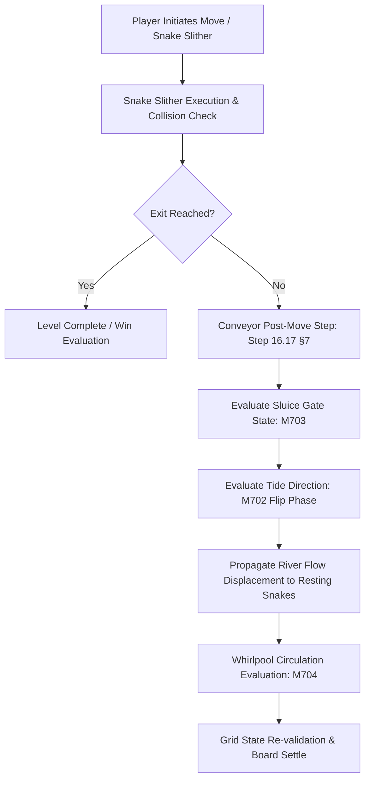

# Technical Specification: Phase 15 Signature System (River Delta: Conveyors & Tracks)

**Status:** Draft  
**Phase:** 15 (Levels 7001–7500)  
**Theme:** River Delta (Conveyors & Tracks)  
**Document Type:** Technical System Specification  
**Source Cross-Reference:** [phases/phase_15/01_PHASE_15_SCOPE_AND_RULES.md](../../phases/phase_15/01_PHASE_15_SCOPE_AND_RULES.md), [phases/phase_15/03_SIGNATURE_SYSTEM_AND_MECHANICS_PHASE_15.md](../../phases/phase_15/03_SIGNATURE_SYSTEM_AND_MECHANICS_PHASE_15.md), [SHARED_CORE_STANDARD.md §11, §16.17](../../SHARED_CORE_STANDARD.md)

---

## 1. Executive Summary & Architectural Overview

Phase 15 introduces the **River Delta: Conveyors & Tracks** signature system into `puzzle_core`. Conveyors represent directional moving waterways/belts overlaid onto grid tiles that transport any resting snake occupying conveyor nodes by 1 tile per turn in the conveyor's active flow vector direction.



---

## 2. Data Structures & State Model

### 2.1 Conveyor Tile Representation (`ConveyorTile`)
```dart
class ConveyorTile {
  final Vector2 flowDirection; // Forward cardinal unit vector (dx, dy)
  final bool isReversible;     // Controlled by M702 Tide River
  bool isActive;              // Controlled by M703 Sluice Lever
  final int? loopId;          // Controlled by M704 Whirlpool Loop
  final int? junctionId;      // Controlled by M701 Belt Junction

  ConveyorTile({
    required this.flowDirection,
    this.isReversible = false,
    this.isActive = true,
    this.loopId,
    this.junctionId,
  });
}
```

### 2.2 Conveyor Grid Engine State (`ConveyorGridState`)
```dart
class ConveyorGridState {
  final Map<Point<int>, ConveyorTile> conveyorMap;
  final Map<int, List<Point<int>>> whirlpoolLoops;
  final Map<int, JunctionState> junctions;
  int currentMoveIndex;
  int tideCyclePeriod; // Default: 4 moves per reversal

  ConveyorGridState({
    required this.conveyorMap,
    required this.whirlpoolLoops,
    required this.junctions,
    this.currentMoveIndex = 0,
    this.tideCyclePeriod = 4,
  });

  bool get isTideReversed => (currentMoveIndex ~/ tideCyclePeriod) % 2 == 1;

  Vector2 getEffectiveFlow(Point<int> pos) {
    final tile = conveyorMap[pos];
    if (tile == null || !tile.isActive) return Vector2.zero();
    if (tile.isReversible && isTideReversed) {
      return tile.flowDirection * -1.0;
    }
    return tile.flowDirection;
  }
}
```

---

## 3. Post-Move Conveyor Step Execution Order (§16.17)

Every turn post-move conveyor physics executes according to the strict deterministic pipeline:
1. **Player Turn Increment:** Turn counter `currentMoveIndex` increments by 1.
2. **Environmental Update:**
   - Tide check: If `currentMoveIndex % tideCyclePeriod == 0`, trigger tide surge VFX and flip flow vectors.
   - Sluice gate check: Sluice gate state updates active/inactive flags.
3. **Snake Candidate Identification:**
   - Scan all snake segments resting on active `ConveyorTile` cells.
4. **Displacement Resolution:**
   - Compute forward target tile `targetPos = currentPos + effectiveFlow`.
   - Validate target tile availability (unoccupied by static obstacle or non-yielding snake).
   - If target is valid, snake segment slides smoothly with ease-out interpolation (200ms).
   - If target is blocked, snake halts ("bonk" ripple VFX, zero progress loss).
5. **Whirlpool Progression:**
   - Snakes inside `loopId` advance by 1 node along loop perimeter clockwise/counter-clockwise.

---

## 4. Integration with Core Puzzle Engine

- **Save/Restore State Serialization:**
  - Serialized within `BoardSnapshot` as `conveyor_data` binary blob.
  - Undo/Redo stack tracks `tideCyclePeriod`, `currentMoveIndex`, and junction positions with deterministic delta compression.
- **Performance Budget:**
  - Conveyor resolution time $\le 1.2\text{ms}$ on low-end test device (Snapdragon 665 / 3GB RAM).
  - Allocation-free iteration over pre-cached coordinate arrays.

---

## 5. References & Cross-Links
- [Phase 15 Base Mechanics](phase-15-base-mechanics.md)
- [Phase 15 Level Plan](phase-15-level-plan-07001-07500.md)
- [Shared Core Standard §11, §16.17](../../SHARED_CORE_STANDARD.md)

