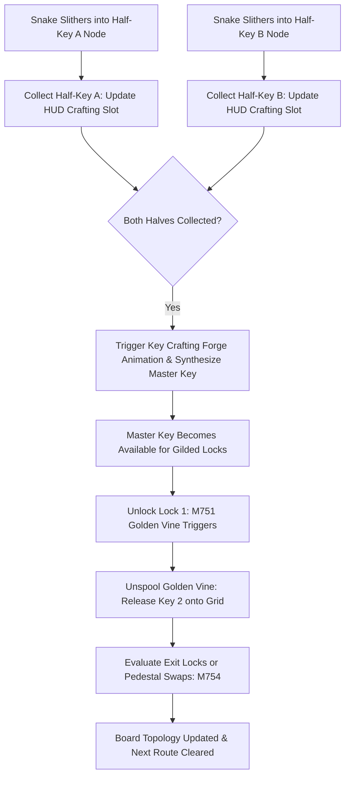

# Technical Specification: Phase 16 Signature System (Treasure Keys: Keys Deluxe)

**Status:** Draft  
**Phase:** 16 (Levels 7501–8000)  
**Theme:** Treasure Keys (Keys Deluxe)  
**Document Type:** Technical System Specification  
**Source Cross-Reference:** [phases/phase_16/01_PHASE_16_SCOPE_AND_RULES.md](../../phases/phase_16/01_PHASE_16_SCOPE_AND_RULES.md), [phases/phase_16/03_SIGNATURE_SYSTEM_AND_MECHANICS_PHASE_16.md](../../phases/phase_16/03_SIGNATURE_SYSTEM_AND_MECHANICS_PHASE_16.md), [SHARED_CORE_STANDARD.md §11, §16.17](../../SHARED_CORE_STANDARD.md)

---

## 1. Executive Summary & Architectural Overview

Phase 16 introduces the **Treasure Keys: Keys Deluxe** signature system into `puzzle_core`. Keys Deluxe models an explicit Directed Acyclic Graph (DAG) of key collection, half-key forging, cascading vine locks, and pedestal swaps. In previous phases, keys simply unlocked color-matched gates. In Phase 16, key unlocking dynamically modifies the board state by unspooling connected keys, synthesizing multi-part master keys, or swapping access tokens across pedestals.



---

## 2. Data Structures & State Model

### 2.1 Key Entity Representation (`KeyEntity`)
```dart
enum KeyType {
  standard,
  halfKeyA,
  halfKeyB,
  skeletonKey, // M753 Golden Master Leaf
}

class KeyEntity {
  final int id;
  final KeyType type;
  final int? colorIndex;
  Point<int>? gridPosition; // null if held in inventory or forged
  bool isCollected;
  final List<int> chainedLockIds; // M751 Key Vine links

  KeyEntity({
    required this.id,
    required this.type,
    this.colorIndex,
    this.gridPosition,
    this.isCollected = false,
    this.chainedLockIds = const [],
  });
}
```

### 2.2 Key Dependency DAG Engine (`KeyDagEngineState`)
```dart
class KeyDagEngineState {
  final Map<int, KeyEntity> keys;
  final Map<int, LockGate> locks;
  final Map<Point<int>, KeySwapPedestal> swapPedestals;
  int halfKeyACount;
  int halfKeyBCount;
  int skeletonKeyCount;

  KeyDagEngineState({
    required this.keys,
    required this.locks,
    required this.swapPedestals,
    this.halfKeyACount = 0,
    this.halfKeyBCount = 0,
    this.skeletonKeyCount = 0,
  });

  bool canForgeMasterKey() => halfKeyACount > 0 && halfKeyBCount > 0;

  void forgeMasterKey() {
    if (canForgeMasterKey()) {
      halfKeyACount--;
      halfKeyBCount--;
      skeletonKeyCount++;
    }
  }

  bool unlockGate(int lockId) {
    final lock = locks[lockId];
    if (lock == null || lock.isUnlocked) return false;
    if (skeletonKeyCount > 0) {
      skeletonKeyCount--;
      lock.isUnlocked = true;
      _triggerVineRelease(lock.dependentKeyId);
      return true;
    }
    return false;
  }

  void _triggerVineRelease(int? keyId) {
    if (keyId != null && keys.containsKey(keyId)) {
      keys[keyId]!.gridPosition = locks[keyId]!.releasePosition;
    }
  }
}
```

---

## 3. Post-Move Key DAG Evaluation Order (§16.17)

Key interactions resolve during step 4 of the core puzzle step pipeline:
1. **Snake Head Intersection Check:**
   - Detect whether any snake head has entered a tile containing a Key or Swap Stone.
2. **Key Collection / Crafting Check:**
   - Add item to inventory counter.
   - If crafting condition met (`halfKeyA + halfKeyB`), trigger forge event immediately.
3. **Lock Release & Vine Unspooling (M751):**
   - Unlocked gate dissolves; if linked by Golden Vine to dependent key, spawn dependent key onto designated grid cell with vine dissolution VFX.
4. **Pedestal Swap Evaluation (M754):**
   - If snake head steps onto active Swap Pedestal, swap held key type with pedestal key type.
5. **Exit Gate Validation:**
   - If target exit gate requirement satisfied, mark gate open.

---

## 4. Integration with Core Puzzle Engine

- **Save/Restore State Serialization:**
  - Serialized within `BoardSnapshot` as `key_dag_data` payload.
  - Full undo/redo fidelity: restoring a prior turn restores exact key positions, crafted inventory, and unspooled vine states.
- **Performance Budget:**
  - Key DAG evaluation time $\le 0.8\text{ms}$ per move.

---

## 5. References & Cross-Links
- [Phase 16 Base Mechanics](phase-16-base-mechanics.md)
- [Phase 16 Level Plan](phase-16-level-plan-07501-08000.md)
- [Shared Core Standard §11, §16.17](../../SHARED_CORE_STANDARD.md)

