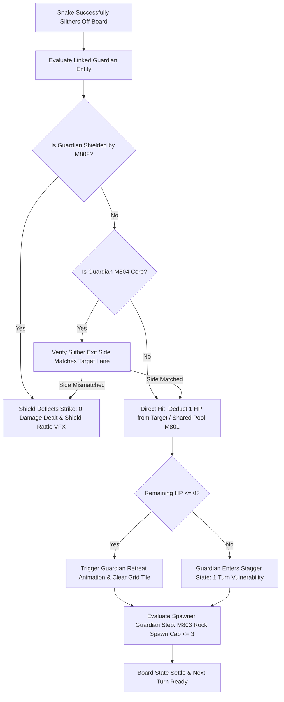

# Technical Specification: Phase 17 Signature System (Mongoose Clan: Guardians)

**Status:** Draft  
**Phase:** 17 (Levels 8001–8500)  
**Theme:** Mongoose Clan (Guardians)  
**Document Type:** Technical System Specification  
**Source Cross-Reference:** [phases/phase_17/01_PHASE_17_SCOPE_AND_RULES.md](../../phases/phase_17/01_PHASE_17_SCOPE_AND_RULES.md), [phases/phase_17/03_SIGNATURE_SYSTEM_AND_MECHANICS_PHASE_17.md](../../phases/phase_17/03_SIGNATURE_SYSTEM_AND_MECHANICS_PHASE_17.md), [SHARED_CORE_STANDARD.md §11, §16.17](../../SHARED_CORE_STANDARD.md)

---

## 1. Executive Summary & Architectural Overview

Phase 17 introduces the **Mongoose Clan: Guardians** signature system into `puzzle_core`. Guardians represent active stationary entities occupying grid territories that block snake paths and/or protect exit tunnels. Rather than static keys or passive obstacles, Guardians possess hit point pools (HP) that deplete as snakes successfully exit the board along connected routing channels.



---

## 2. Data Structures & State Model

### 2.1 Guardian Entity Representation (`GuardianEntity`)
```dart
enum GuardianType {
  twin,    // M801: Shared HP pool across twin entities
  shield,  // M802: Invulnerable when shield lever is active
  spawner, // M803: Periodically spawns obstacle rocks
  core,    // M804: Directional vulnerability core
}

class GuardianEntity {
  final int id;
  final GuardianType type;
  final Point<int> position;
  int currentHp;
  final int maxHp;
  bool isShielded;
  final int? sharedPoolId;
  final List<Vector2> vulnerableExitSides; // M804 Core requirement

  GuardianEntity({
    required this.id,
    required this.type,
    required this.position,
    required this.currentHp,
    required this.maxHp,
    this.isShielded = false,
    this.sharedPoolId,
    this.vulnerableExitSides = const [],
  });

  bool get isDefeated => currentHp <= 0;
}
```

### 2.2 Guardian Engine State (`GuardianEngineState`)
```dart
class GuardianEngineState {
  final Map<int, GuardianEntity> guardians;
  final Map<int, int> sharedHpPools; // poolId -> sharedHp
  int activeSpawnedObstacles;
  final int maxSpawnedObstacles; // Strict cap = 3

  GuardianEngineState({
    required this.guardians,
    required this.sharedHpPools,
    this.activeSpawnedObstacles = 0,
    this.maxSpawnedObstacles = 3,
  });

  bool applyDamageToGuardian(int guardianId, Vector2 exitVector) {
    final guardian = guardians[guardianId];
    if (guardian == null || guardian.isDefeated || guardian.isShielded) return false;

    if (guardian.type == GuardianType.core &&
        !guardian.vulnerableExitSides.contains(exitVector)) {
      return false; // Mismatched attack angle
    }

    if (guardian.sharedPoolId != null) {
      final poolHp = sharedHpPools[guardian.sharedPoolId!] ?? 0;
      if (poolHp > 0) {
        sharedHpPools[guardian.sharedPoolId!] = poolHp - 1;
        if (sharedHpPools[guardian.sharedPoolId!]! <= 0) {
          for (final g in guardians.values.where((e) => e.sharedPoolId == guardian.sharedPoolId)) {
            g.currentHp = 0;
          }
        }
        return true;
      }
    } else {
      guardian.currentHp = math.max(0, guardian.currentHp - 1);
      return true;
    }
    return false;
  }
}
```

---

## 3. Post-Move Guardian Step Execution Order (§16.17)

Guardian mechanics execute deterministically within the turn sequence:
1. **Player Turn Action:** Snake slithers toward exit or player taps M802 Shield Lever (`Move += 1`).
2. **Lever Toggle:** If shield lever is switched, flip `isShielded` flag immediately.
3. **Snake Exit Resolution:**
   - Detect successful snake clearance from board.
   - Map clearing route to linked Guardian.
   - If unshielded and direction matches, decrement Guardian HP.
4. **Defeat Resolution:**
   - If HP drops to zero, play retreat animation (puff of smoke + scurrying footprint trail) and unblock previously defended tile.
5. **Spawner Tick (M803):**
   - If move counter modulo $N == 0$ and `activeSpawnedObstacles < 3`, Mama Mongoose spawns a breakable rock in the nearest free adjacent cell.
6. **Board Settle:** Revalidate snake paths and update HUD boss HP bar.

---

## 4. Integration with Core Puzzle Engine

- **Save/Restore State Serialization:**
  - Serialized within `BoardSnapshot` as `guardian_state_data`.
  - Reversing a move restores guardian HP, removes newly spawned rocks, and restores defeated guardians without desync.
- **Performance Budget:**
  - Guardian step execution time $\le 1.0\text{ms}$ per move.

---

## 5. References & Cross-Links
- [Phase 17 Base Mechanics](phase-17-base-mechanics.md)
- [Phase 17 Level Plan](phase-17-level-plan-08001-08500.md)
- [Shared Core Standard §11, §16.17](../../SHARED_CORE_STANDARD.md)
