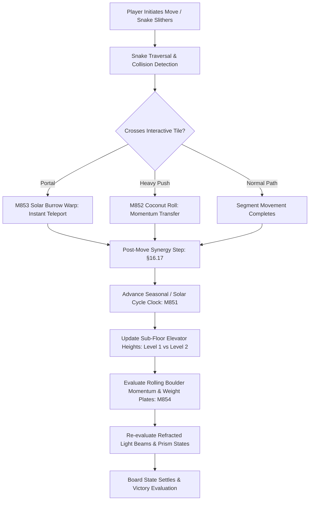

# Technical Specification: Phase 18 Signature System (Remix A: Early Eras Synergy)

**Status:** Draft  
**Phase:** 18 (Levels 8501–9000)  
**Theme:** Remix A (Early Eras Synergy / Data-Driven)  
**Document Type:** Technical System Specification  
**Source Cross-Reference:** [phases/phase_18/01_PHASE_18_SCOPE_AND_RULES.md](../../phases/phase_18/01_PHASE_18_SCOPE_AND_RULES.md), [phases/phase_18/03_SIGNATURE_SYSTEM_AND_MECHANICS_PHASE_18.md](../../phases/phase_18/03_SIGNATURE_SYSTEM_AND_MECHANICS_PHASE_18.md), [SHARED_CORE_STANDARD.md §11, §16.17](../../SHARED_CORE_STANDARD.md), [SCALING_TO_10000_LEVELS.md §6, §9](../../SCALING_TO_10000_LEVELS.md)

---

## 1. Executive Summary & Architectural Overview

Phase 18 introduces **Remix A: Early Eras Synergy** into `puzzle_core`. Rather than introducing an isolated new concept, Remix A cross-breeds top-performing core mechanics from Phases 1 to 6 (Day/Night cycles, Elevator floors, Rolling coconuts, Light refraction prisms, Burrow portals, and Weight switches) into an integrated composite engine state. Mechanics interact dynamically across layers—for instance, daylight cycle changes raise or lower sub-floor elevators, and focused light beams melt obstacles or guide rolling coconuts onto pressure plates.



---

## 2. Data Structures & State Model

### 2.1 Synergy Composite State (`RemixCompositeEngineState`)
```dart
class RemixCompositeEngineState {
  int cycleTurnIndex;
  final int cyclePeriod; // e.g. 5 moves per cycle shift
  final Map<Point<int>, int> floorHeights; // 1 = lower, 2 = upper
  final Map<Point<int>, CoconutEntity> rollingCoconuts;
  final Map<Point<int>, Point<int>> burrowPortals; // Entry -> Exit pairs
  final Map<Point<int>, int> pressurePlates; // Required weight -> current weight
  final List<LightBeamRay> activeBeams;

  RemixCompositeEngineState({
    this.cycleTurnIndex = 0,
    this.cyclePeriod = 5,
    required this.floorHeights,
    required this.rollingCoconuts,
    required this.burrowPortals,
    required this.pressurePlates,
    required this.activeBeams,
  });

  bool get isElevatedPhase => (cycleTurnIndex ~/ cyclePeriod) % 2 == 1;

  void advanceTurn() {
    cycleTurnIndex++;
    _updateElevators();
    _processCoconutMomenta();
    _recalculateBeams();
  }

  void _updateElevators() {
    // Elevate or lower designated tiles based on phase
  }

  void _processCoconutMomenta() {
    // Advance rolling boulders along inertia vectors
  }

  void _recalculateBeams() {
    // Cast raycasts across grid reflecting off prisms
  }
}
```

---

## 3. Post-Move Composite Execution Order (§16.17)

Every turn follows the strict deterministic multi-system resolution pipeline:
1. **Snake Slither Resolution:** Active snake advances along user-selected route.
2. **Portal Teleport Check (M853):** If snake head enters a solar burrow portal, instantaneously translate coordinates to the paired exit portal.
3. **Rolling Boulder Trigger (M852):** If snake pushes a coconut boulder, roll it forward until it collides with a wall, enters a prism beam, or depresses a plate.
4. **Cycle Clock Advance (M851):** Increment `cycleTurnIndex`. When threshold reached, trigger floor elevation change with mechanical gear dust VFX.
5. **Weight Plate Evaluation (M854):** Update trapdoor open/shut state based on current boulder weight on plates.
6. **Refraction Raycast Recalculation:** Update solar prism beams across transformed grid geometry.
7. **Board Settle:** Validate all snake resting states.

---

## 4. Analytics-Driven Selection Criteria (§9)
Pursuant to `SCALING_TO_10000_LEVELS.md §9`, the 4 composite mechanics integrated in Phase 18 satisfy the telemetry score formula:
$$\text{Score}(M) = \frac{\text{CompletionRate}(M) \times \text{FunRating}(M)}{\text{AbandonmentRate}(M) \times (1 + \text{BoosterReliance})}$$
Eligible mechanics represent the highest completion ($\ge 85\%$) and lowest churn mechanics from the first six phases.

---

## 5. References & Cross-Links
- [Phase 18 Base Mechanics](phase-18-base-mechanics.md)
- [Phase 18 Level Plan](phase-18-level-plan-08501-09000.md)
- [Shared Core Standard §11, §16.17](../../SHARED_CORE_STANDARD.md)
