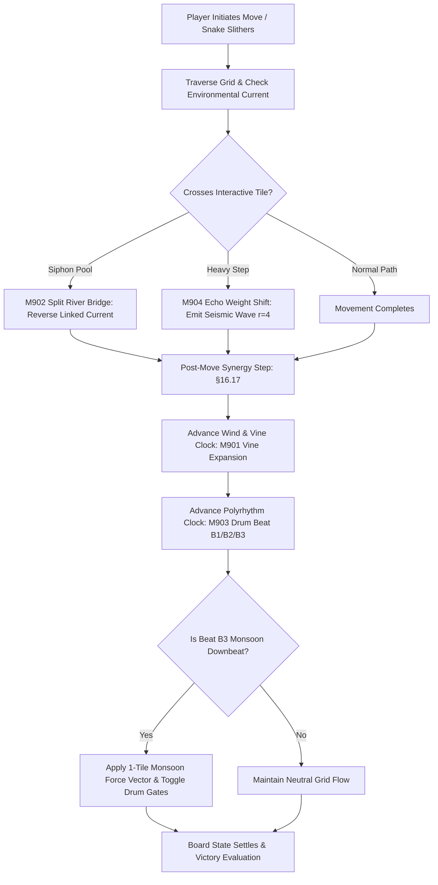

# Technical Specification: Phase 19 Signature System (Remix B: Late Eras Synergy)

**Status:** Draft  
**Phase:** 19 (Levels 9001–9500)  
**Theme:** Remix B (Phase 7 to Phase 12 Mechanics Synergy)  
**Document Type:** Technical System Specification  
**Source Cross-Reference:** [phases/phase_19/01_PHASE_19_SCOPE_AND_RULES.md](../../phases/phase_19/01_PHASE_19_SCOPE_AND_RULES.md), [phases/phase_19/03_SIGNATURE_SYSTEM_AND_MECHANICS_PHASE_19.md](../../phases/phase_19/03_SIGNATURE_SYSTEM_AND_MECHANICS_PHASE_19.md), [SHARED_CORE_STANDARD.md §11, §16.17](../../SHARED_CORE_STANDARD.md), [SCALING_TO_10000_LEVELS.md §6, §9](../../SCALING_TO_10000_LEVELS.md)

---

## 1. Executive Summary & Architectural Overview

Phase 19 introduces **Remix B: Late Eras Synergy** into `puzzle_core`. Remix B orchestrates deep physics and dynamic environmental interactions by fusing top-tier signature mechanics from Phases 7 to 12 (Gusts, Overgrown Vines, Twin Rivers, Rhythm Drum Gates, Reflection Ponds, and Monsoon Heavy Pythons). Mechanics couple synchronously—wind gusts direct vine growth, pond sluices reverse river conveyors, drum downbeats trigger torrential gravity pushes, and heavy snake impacts send acoustic seismic shockwaves through distant echo gates.



---

## 2. Data Structures & State Model

### 2.1 Late Era Synergy Engine State (`RemixBLateEraState`)
```dart
class RemixBLateEraState {
  Vector2 currentWindVector; // North, South, East, West
  int rhythmBeatIndex; // 0, 1, 2 (Modulo 3)
  final Map<Point<int>, VineNode> vineGrid;
  final Map<int, RiverCurrentChannel> coupledRivers;
  final Map<Point<int>, EchoGate> echoGates;
  final Set<Point<int>> submergedLilyPads;

  RemixBLateEraState({
    required this.currentWindVector,
    this.rhythmBeatIndex = 0,
    required this.vineGrid,
    required this.coupledRivers,
    required this.echoGates,
    required this.submergedLilyPads,
  });

  bool get isMonsoonDownbeat => (rhythmBeatIndex % 3) == 2;

  void advanceTurn() {
    rhythmBeatIndex++;
    _processWindBiasedVines();
    _processRhythmMonsoonPulse();
  }

  void _processWindBiasedVines() {
    // Expand active vines 1 tile along currentWindVector if unobstructed
  }

  void _processRhythmMonsoonPulse() {
    // If isMonsoonDownbeat, apply 1-tile force displacement and toggle drum gates
  }
}
```

---

## 3. Post-Move Composite Execution Order (§16.17)

Every turn post-move mechanics resolve via the strict deterministic sequence:
1. **Snake Movement Resolution:** Active snake slithers along designated path.
2. **Seismic Weight Check (M904):** If heavy python (weight $\ge 2\times$) completes move on pressure node, propagate seismic shockwave radius $r=4$ Manhattan distance, opening matching Echo Gates for 3 turns.
3. **Hydraulic Siphon Check (M902):** If snake steps onto reflection lily pad, toggle connected river gate and reverse current vector.
4. **Wind-Driven Vine Step (M901):** On every 2nd move, expand vine tip 1 tile along `currentWindVector`. If blocked by wall or opposing wind, growth halts.
5. **Rhythm Monsoon Pulse (M903):** Advance beat counter. On downbeat $B_3$, apply 1-tile directional wind push to all resting snakes and toggle Drum Gates (Open $\leftrightarrow$ Closed).
6. **Board Settle:** Settle displaced snakes and validate board topology.

---

## 4. Analytics-Driven Selection Criteria (§9)
In compliance with `SCALING_TO_10000_LEVELS.md §9`, the 4 late-era synergies represent high-completion ($\ge 85\%$) mechanics with the lowest recorded player churn across the mid-to-late phases.

---

## 5. References & Cross-Links
- [Phase 19 Base Mechanics](phase-19-base-mechanics.md)
- [Phase 19 Level Plan](phase-19-level-plan-09001-09500.md)
- [Shared Core Standard §11, §16.17](../../SHARED_CORE_STANDARD.md)

