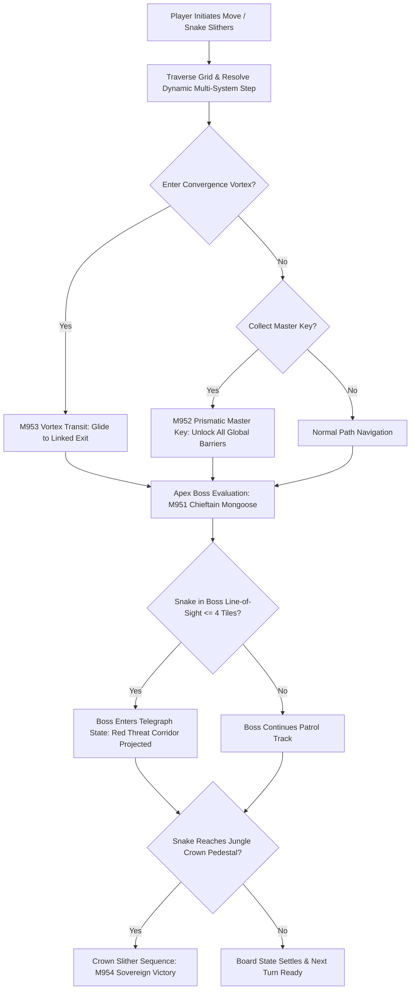

# Technical Specification: Phase 20 Signature System (Grand Jungle Master & Level 10,000 Summit)

**Status:** Draft  
**Phase:** 20 (Levels 9501–10,000)  
**Theme:** Grand Jungle Master (All Systems Culmination & Level 10,000 Grand Finale)  
**Document Type:** Technical System Specification  
**Source Cross-Reference:** [phases/phase_20/01_PHASE_20_SCOPE_AND_RULES.md](../../phases/phase_20/01_PHASE_20_SCOPE_AND_RULES.md), [phases/phase_20/03_SIGNATURE_SYSTEM_AND_MECHANICS_PHASE_20.md](../../phases/phase_20/03_SIGNATURE_SYSTEM_AND_MECHANICS_PHASE_20.md), [SHARED_CORE_STANDARD.md §11, §16.17](../../SHARED_CORE_STANDARD.md), [SCALING_TO_10000_LEVELS.md §6](../../SCALING_TO_10000_LEVELS.md)

---

## 1. Executive Summary & Architectural Overview

Phase 20 represents the pinnacle summit of *Snakes Slither*, bringing all 14 signature systems (burrows, ice, elevators, coconuts, prisms, wind, vines, rivers, drum gates, reflection ponds, gravity monsoons, conveyors, keys deluxe, and guardians) into a unified master engine state. The signature system culminates in the **Grand Jungle Master** framework featuring the Apex Chieftain Mongoose Boss encounter, Prismatic Omni-Keys, multi-dimensional Convergence Vortexes, and the Jungle Crown Pedestal win condition.



---

## 2. Data Structures & State Model

### 2.1 Master Boss & Apex Engine State (`GrandMasterEngineState`)
```dart
enum BossState {
  patrol,
  telegraph, // Threat corridor visible; strikes next turn
  strike,    // 3-tile linear rush
  stunned,   // 3 turns incapacitated
}

class ApexBossEntity {
  final Point<int> anchor; // 2x2 footprint top-left
  BossState state;
  Vector2 facingDirection;
  int stunTurnsRemaining;
  List<Point<int>> projectedThreatCells;

  ApexBossEntity({
    required this.anchor,
    this.state = BossState.patrol,
    required this.facingDirection,
    this.stunTurnsRemaining = 0,
    this.projectedThreatCells = const [],
  });
}

class GrandMasterEngineState {
  final ApexBossEntity? apexBoss;
  bool isMasterKeyCollected;
  final Map<Point<int>, Point<int>> convergenceVortexes;
  final Point<int> crownPedestalPosition;
  bool isCrownAttained;

  GrandMasterEngineState({
    this.apexBoss,
    this.isMasterKeyCollected = false,
    required this.convergenceVortexes,
    required this.crownPedestalPosition,
    this.isCrownAttained = false,
  });

  void processBossTurn(List<SnakeEntity> snakes) {
    if (apexBoss == null || apexBoss!.state == BossState.stunned) {
      if (apexBoss?.state == BossState.stunned) {
        apexBoss!.stunTurnsRemaining--;
        if (apexBoss!.stunTurnsRemaining <= 0) {
          apexBoss!.state = BossState.patrol;
        }
      }
      return;
    }
    // Strict turn-based deterministic state machine execution
  }
}
```

---

## 3. Post-Move Master Step Execution Order (§16.17)

Every turn post-move mechanics resolve deterministically in this order:
1. **Snake Slither Resolution:** Active snake advances along path.
2. **Convergence Vortex Check (M953):** If snake enters vortex, glide to paired outlet maintaining snake tail curvature continuity.
3. **Master Key Collection (M952):** If snake head contacts Prismatic Master Key, simultaneously set all elemental locks on board to unlocked.
4. **Apex Boss Step (M951):**
   - If boss was in `telegraph` state, execute linear 3-tile rush along threat corridor. If snake is struck, fail level. If boss strikes wall, trapdoor, or vortex, enter `stunned` state for 3 turns.
   - If boss was in `patrol`, scan cardinal corridors ($\le 4$ tiles). If snake spotted, enter `telegraph` state and render red runic warning tiles.
5. **Crown Pedestal Check (M954):** If designated snake head mounts the Jungle Crown Pedestal, trigger sovereign victory fanfare.
6. **Board Settle:** Settle dynamic board states.

---

## 4. Integration with Core Puzzle Engine

- **Strict Turn-Based Determinism:** Boss encounters require zero twitch reflexes. Player has infinite time to deliberate each move.
- **Save/Restore State Serialization:**
  - Serialized within `BoardSnapshot` as `grand_master_data`.
  - Reversing a move restores exact boss patrol positions, stun counters, threat projections, and crown pedestal states.
- **Performance Budget:**
  - Grand Master step execution time $\le 1.2\text{ms}$ per move.

---

## 5. References & Cross-Links
- [Phase 20 Base Mechanics](phase-20-base-mechanics.md)
- [Phase 20 Level Plan](phase-20-level-plan-09501-10000.md)
- [Shared Core Standard §11, §16.17](../../SHARED_CORE_STANDARD.md)

