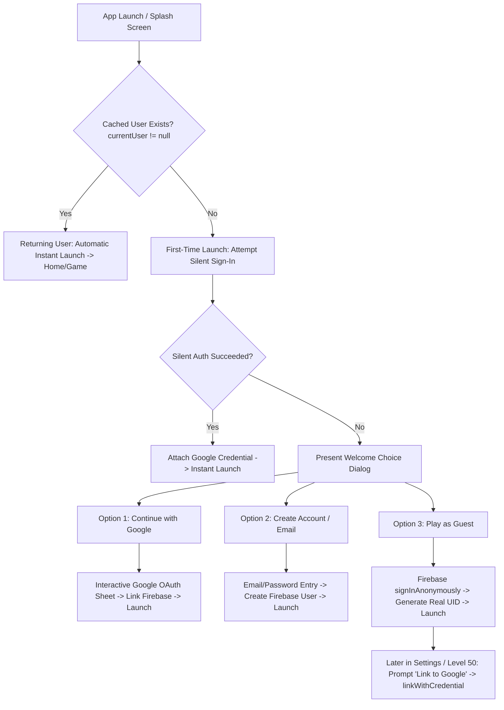

# Spec: Authentication, Silent Sign-In and Account Linking

## Status
Draft

## Type
New Feature

## Goal
Establish a seamless, frictionless authentication architecture supporting first-time silent Google Sign-In, non-blocking Guest Mode onboarding via Firebase Anonymous Auth, persistent session tokens with zero daily re-authentication prompts, and non-destructive cloud account linking for Yarn Unravel.

---

## Current State
- Design partially referenced in [SHARED_CORE_STANDARD.md §14](../../SHARED_CORE_STANDARD.md) and [offline-and-cloud-sync.md](offline-and-cloud-sync.md) under Phase 2 backend requirements.
- Currently, no dedicated authentication service, silent sign-in pipeline, or guest-to-cloud onboarding UI exists in the codebase.
- Player onboarding risks high drop-off if forced through a mandatory registration wall upon first launch.

---

## Proposed Change

### 1. Architectural Philosophy: "Silent First, Frictionless Guest Fallback, Zero Daily Re-login"
1. **Never Block Gameplay:** New players must reach gameplay within 2 taps or 5 seconds of launching the app.
2. **Device Google Play Account vs App OAuth:** The app cannot assume OS-level Google Play Store accounts grant automatic OAuth2 permissions without explicit user consent.
3. **Silent Background Attempt:** On the first launch, the app attempts silent authentication via `GoogleSignIn.signInSilently()` or Play Games Services v2.
4. **Clean 3-Way Choice Fallback:** If silent sign-in fails or requires interactive consent, display an unintrusive Welcome Dialog:
   - **Continue with Google** (Primary high-prominence action).
   - **Create Account / Email** (Secondary action).
   - **Play as Guest** (Low-friction instant skip).
5. **Persistent Session Token:** Once authenticated (Google, Email, or Guest), the credentials persist in Android Keystore / iOS Keychain. Daily launches require 0 taps and 0 logins.
6. **Zero Data Loss Account Linking:** Guest accounts can link to a permanent Google account at any time via `linkWithCredential()`, preserving all offline and local progress.

---

### 2. State & Sequence Flowchart



---

### 3. Detailed Technical Components

#### 3.1 First-Time Silent Sign-In Pipeline
- During native splash launch ([splash-and-instant-launch.md](splash-and-instant-launch.md)), `AuthService.checkInitialAuth()` executes:
  ```dart
  Future<User?> checkInitialAuth() async {
    // 1. Returning user check (cached session)
    if (_auth.currentUser != null) {
      return _auth.currentUser;
    }

    // 2. Background silent Google Sign-In attempt
    try {
      final GoogleSignInAccount? googleUser = await _googleSignIn.signInSilently();
      if (googleUser != null) {
        return await _firebaseAuthWithGoogle(googleUser);
      }
    } catch (e) {
      // Expected if no prior consent; proceed to welcome dialog
    }
    return null; // Signals UI to show Welcome Dialog
  }
  ```

#### 3.2 Guest Mode via Firebase Anonymous Auth
- If player taps "Play as Guest":
  - Call `FirebaseAuth.instance.signInAnonymously()`.
  - A valid Firebase `uid` is generated and assigned.
  - All local game progress (levels, coins, unlocked wool palettes, stars) writes to local Hive boxes and syncs to Firestore under path `/users/{uid}/saveData`.
  - Player experiences zero functional difference compared to a logged-in user.

#### 3.3 Returning User Session Persistence
- Mobile OS secure storage maintains the Firebase Refresh Token.
- On subsequent app opens:
  - `_auth.currentUser` is immediately non-null.
  - The JWT ID Token refreshes automatically in the background (1-hour validity window).
  - No interactive dialog, account chooser, or spinner appears.

#### 3.4 Guest-to-Permanent Account Linking Pipeline
- When a guest user chooses to secure their account (from Settings $\to$ "Cloud Backup" or milestone prompts at Level 20/50):
  ```dart
  Future<AuthResult> linkGuestToGoogle() async {
    final GoogleSignInAccount? googleUser = await _googleSignIn.signIn();
    if (googleUser == null) return AuthResult.cancelled;

    final GoogleSignInAuthentication googleAuth = await googleUser.authentication;
    final AuthCredential credential = GoogleAuthProvider.credential(
      accessToken: googleAuth.accessToken,
      idToken: googleAuth.idToken,
    );

    try {
      // Merges anonymous UID with Google identity: NO PROGRESS LOST
      await _auth.currentUser!.linkWithCredential(credential);
      return AuthResult.success;
    } on FirebaseAuthException catch (e) {
      if (e.code == 'credential-already-in-use') {
        return _handleAccountConflict(credential);
      }
      rethrow;
    }
  }
  ```

#### 3.5 Account Conflict Resolution
- If the chosen Google account already holds a previous cloud save from another device:
  - Never automatically overwrite or merge without user consent.
  - Display the canonical **Conflict Resolution Modal**:
    - **Keep Device Save:** (Replaces cloud save with current local progress).
    - **Restore Cloud Save:** (Downloads existing cloud save, overwriting local).
    - Details displayed for each: Level reached, Coin balance, Last played timestamp.

---

## Affected Files
- `packages/puzzle_core/lib/src/services/auth_service.dart` (to be created)
- `packages/puzzle_core/lib/src/services/cloud_sync_service.dart` (to be updated)
- `lib/src/ui/dialogs/welcome_auth_dialog.dart` (to be created)
- `lib/src/ui/dialogs/account_conflict_dialog.dart` (to be created)
- `lib/src/ui/screens/settings_account_section.dart` (to be updated)
- `specs/INDEX.md` (to be updated)

---

## Design

### 1. Welcome Auth Dialog (First-Time Unauthenticated Fallback)
```
+-----------------------------------------------------------+
|                   WELCOME TO YARN UNRAVEL!                |
|                                                           |
|       Save your progress across devices and play with     |
|                   friends seamlessly.                     |
|                                                           |
|       +---------------------------------------------+     |
|       |   [G]  Continue with Google                 |     |
|       +---------------------------------------------+     |
|                                                           |
|       +---------------------------------------------+     |
|       |   [Envelope] Sign in with Email             |     |
|       +---------------------------------------------+     |
|                                                           |
|                   [ Play as Guest (Skip) ]                |
+-----------------------------------------------------------+
```

### 2. Design Tokens
- Primary Button: Cozy Rose (`#E57373`), white bold text, Google multi-colored icon.
- Secondary Button: Soft Wool Cream (`#FFF3E0`), dark charcoal text.
- Guest Link: Subtle text button with underline, muted thread gray (`#90A4AE`).
- Touch Hitbox: Full width with minimum $52\text{ dp}$ height for thumb ergonomics.

---

## API Changes
- Firebase Auth REST endpoints (standard Firebase SDK protocols):
  - `POST /identitytoolkit/v3/relyingparty/signupNewUser?key={apiKey}` (Anonymous signup)
  - `POST /identitytoolkit/v3/relyingparty/verifyAssertion?key={apiKey}` (Google OAuth verify)
  - `POST /identitytoolkit/v3/relyingparty/setAccountInfo?key={apiKey}` (Credential link)

---

## Database Changes
- Firestore User Document Schema (`/users/{uid}`):
  ```json
  {
    "uid": "string",
    "isAnonymous": false,
    "providerId": "google.com",
    "email": "user@example.com",
    "displayName": "Yarn Weaver",
    "createdAt": "2026-10-29T18:00:00Z",
    "lastLoginAt": "2026-10-29T18:00:00Z",
    "saveData": {
      "highestUnlockedLevel": 124,
      "coins": 3450,
      "stars": 360,
      "schemaVersion": 2
    }
  }
  ```

---

## Risks & Mitigations

| Risk | Impact | Mitigation Strategy |
| :--- | :---: | :--- |
| **Silent Sign-In Network Timeout** | Launch Delay | Enforce strict 1.5s timeout on silent sign-in; fall back immediately to Welcome Dialog or offline guest play. |
| **Accidental Guest Data Wipe** | Player Frustration | Automatic background anonymous auth ensures local storage is never discarded; periodic prompts encourage Google linking. |
| **Credential-Already-In-Use Collision** | Save Overwrite | Explicit Account Conflict Dialog gives player choice between local and cloud save with clear level/coin metadata. |
| **OAuth Consent Cancellation** | User Stuck | If user dismisses Google account selector, gracefully return to Welcome Dialog with "Play as Guest" available. |

---

## Open Questions
- **Open Question AUTH-01:** Prioritize Google Play Games Services (PGS v2) on Android for zero-popup silent authentication, and Sign in with Apple on iOS, with standard Google Sign-In as unified fallback.

---

## References & Cross-Links
- [Shared Core Standard §14](../../SHARED_CORE_STANDARD.md)
- [Offline and Cloud Sync Specification](offline-and-cloud-sync.md)
- [Splash and Instant Launch Specification](splash-and-instant-launch.md)

